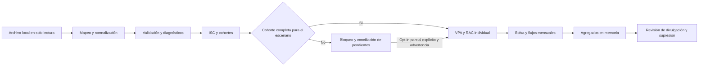

# Adaptación local y validación — fase 3

## Alcance y separación de responsabilidades

Esta fase utiliza **exclusivamente datos sintéticos**. No se leyó, solicitó ni descargó una base corporativa. El adaptador prepara una interfaz para un uso local posterior autorizado; no acredita calidad institucional, elegibilidad pensional, viabilidad de producto ni autorización legal de una garantía.



La lectura reutiliza `loader.load_workbook`. Abre el Excel con `rb`, cierra el archivo y procesa una copia binaria en memoria; verifica cabeceras duplicadas antes de aceptar la hoja. `read_local_source` no escribe en el original ni en `data/raw`. La lectura del archivo y la modelación son capas distintas: el simulador solo recibe objetos en memoria.

## Variables y procedencia

| Variable interna | Procedencia y requisito |
|---|---|
| `registro` | Columna fuente expresamente mapeada. Única, no vacía y no nula. No se fabrica ni deduplica. |
| `fecha_corte` | Fecha de valoración fuente, o fecha global configurada si falta la columna. No se infiere de fecha de generación. |
| `riesgo`, `riesgo_normalizado` | Categoría original y clasificación del catálogo configurado. |
| `edad` | Edad fuente, numérica en [0,120] para la adaptación. Su ausencia no impide calcular ISC. |
| `sexo` | Código fuente con correspondencias configuradas a F/M. `*` solo bajo una codificación/hipótesis unisex explícita. No se completa automáticamente un sexo faltante. |
| `beneficiarios_estado` | `none_confirmed`, `known`, `unavailable`, `unsupported`; ausencia queda pendiente. |
| `beneficiarios` | Objeto `Beneficiary` explícito en memoria para el caso independiente implementado. No se interpreta JSON arbitrario ni se presume una familia a partir de campos incompletos. |
| `capital_mas_bono` | Capital disponible fuente bajo definición/unidad validadas. |
| `capital_necesario_sm` | Requerimiento individual fuente: denominador ISC, no pasivo de la bolsa. |
| `prestacion_mensual` | Valor fuente o escenario configurado y fechado; nunca se equipara automáticamente mesada y SMMLV. |
| `ISC` | Cociente calculado; nulo si capital inválido o denominador no positivo. |
| Mortalidad, descuento, indexación y gastos | Objetos globales `ActuarialConfiguration` y `LiabilityAssumptions`; no se repiten por fila. |

Mínimo estructural para ISC: riesgo y los dos capitales. Su cálculo financiero no requiere edad, sexo, beneficiarios ni prestación objetivo. Para valorar se exigen además identificación/unidad, fecha/unidades, edad/sexo compatibles, prestación, beneficiarios y configuración completa. Un registro pendiente actuarial puede conservarse en la descripción y el universo ISC.

`minimum_schema` cuenta filas con capital no negativo y finito, denominador positivo/finito y riesgo no vacío: es un indicador mínimo de estructura/tipo, **no** un certificado de aplicabilidad o valoración.

## Configuración local y transformaciones

Los ejemplos `config/data_mapping.example.yaml` y `config/risk_catalog.example.yaml` son sintéticos/provisionales. Las configuraciones corporativas deben guardarse **fuera del repositorio**. El cargador YAML usa `safe_load`, no busca archivos locales automáticamente y rechaza configuraciones internas al repositorio salvo nombres terminados en `.example.yaml`. `.gitignore` solo permite esos ejemplos en `config/` y excluye variantes `.local.yaml/.yml/.json`.

`DataMapping` recibe correspondencias columna original → nombre interno, fecha/formato de valoración, moneda fuente/modelo, fecha de precios, multiplicador monetario explícito, unidad de observación, códigos de sexo y escenario de prestación.

Se reutiliza la normalización de encabezados existente y se rechazan colisiones. Columnas ajenas al esquema, como nombres o documentos, se descartan del DataFrame adaptado. Solo se conservan identificadores necesarios internamente, nunca se exportan automáticamente. Se registran transformaciones y cantidades agregadas, sin muestras de valores.

No numéricos/no finitos pasan a nulo **con diagnóstico**; negativos quedan visibles y bloqueados. No hay imputación individual. Los valores monetarios se escalan únicamente con multiplicador explícito; no se convierten divisas ni se consultan tasas. COP y unidades ABSTRACT se distinguen y deben coincidir entre fuente/modelo; un código de moneda de fila incompatible genera alerta. Fecha de precios y valoración deben coincidir en esta versión: no se reexpresa inflación sin regla autorizada. Fechas incompatibles/ambiguas quedan pendientes.

Si `registro` se repite, todas las filas implicadas quedan pendientes de unidad de análisis. No se decide arbitrariamente si representan personas, cuentas o beneficiarios. `observation_unit='pensionado'` debe ser una decisión documentada del usuario autorizado, no una conclusión inferida por el programa.

### Prestación

- `provided`: utiliza la columna `prestacion_mensual` mapeada.
- `current`: utiliza `mesada` como prestación vigente, sin llamarla SMMLV.
- `smmlv`: exige valor suministrado y fecha coincidente con valoración.
- `explicit`: otro escenario expresamente suministrado y fechado.

Si no existe valor SMMLV configurado, el registro queda pendiente; no se consulta internet ni se incorpora una cifra externa. Un importe configurado se expresa en unidades del modelo; el multiplicador monetario transforma únicamente importes de la fuente.

## Fuente única de verdad ISC

`RiskCatalog` declara reglas booleanas y aliases explícitos. Normaliza tildes, espacios y guiones. GPM y SUSTITUCIÓN-GPM siguen excluidos: no pueden reactivarse mediante reglas/aliases. Desconocidos y faltantes no se incorporan por descarte al universo aplicable.

El catálogo se adjunta al DataFrame clasificado y se hereda por todos los consumidores ISC, incluidos escenarios, universos, cohortes y gráficas históricas. Un intento de usar otro catálogo en un consumidor genera error; `calculate_isc(..., catalog=nuevo)` permite una **reclasificación explícita**. No se infiere el catálogo observando categorías del archivo.

El catálogo por defecto es provisional. Para que sus registros sean valorables se requiere aceptar explícitamente esa condición en el escenario sintético (`allow_provisional_catalog=True`). Ese flag no sustituye una validación institucional.

`reconcile_isc` informa total; excluidos por regla; desconocidos; faltantes; aplicables; aplicables calculables/no calculables; ISC<1 y >=1. Solo los estados de riesgo forman la partición superior; los indicadores subordinados no deben sumarse al total. Se verifica:

- total = excluidos + desconocidos + faltantes + aplicables;
- aplicables = calculables aplicables + no calculables aplicables;
- calculables aplicables = ISC<1 + ISC>=1.

`compare_historical_counts` acepta referencias suministradas por el usuario, devuelve diferencias y alerta para revisar catálogo/versiones, faltantes, calidad y unidad de análisis. Las referencias históricas de 94.055 totales, 30.037 aplicables, 30.036 calculables aplicables y 19.356 ISC<1 son **solo referencias futuras de conciliación**: no se codifican como objetivos del modelo ni se han comprobado con datos reales.

## Diagnósticos y estado principal

`ValidationResult.causes` conserva múltiples problemas por fila en memoria. `by_cause` cuenta cada alerta sobre el total leído; sus cantidades/porcentajes pueden superponerse. `by_state` asigna una única categoría por fila y debe sumar el total.

Jerarquía principal: identificación/unidad → no aplicable ISC → riesgo pendiente → capital → ISC → edad → sexo → fecha → moneda → prestación → beneficiarios → hipótesis → cobertura de mortalidad → preparado. Esta jerarquía representa orden de procesamiento, **no gravedad, prioridad social ni elegibilidad pensional**. Las causas adicionales no se borran.

Se informa total leído, mínimo estructural, ISC calculable en toda la base, seleccionados por cohorte, preparados, pendientes actuariales, riesgos pendientes, identificación y simulados. Las causas pueden contarse en varios indicadores; los estados son la única partición de preparación.

## Beneficiarios, mortalidad y cola

`none_confirmed` solo significa inexistencia confirmada por la información autorizada, no ausencia de campos. Una estructura familiar no vacía contradice ese estado y bloquea. `known` exige un objeto caracterizado compatible. `unavailable`, `unsupported` y datos faltantes generan pendientes. Múltiples beneficiarios y reglas reales de sustitución no están implementados.

`mortality_from_frame` admite una tabla en memoria con `age`, `sex`, `period` (etiqueta anual de valoración), `annual_q` y factor opcional `improvement_factor`. Exige fuente, versión, vigencia y año de valoración. Valida probabilidades, claves únicas, sexo y períodos. Sin una combinación de edad/sexo/año requerida, no extrapola: el registro queda pendiente. La vigencia se comprueba contra la fecha de valoración; el período consultado es año de valoración + años completos de proyección desde la fecha de valoración. Esta interfaz usa aniversarios de valoración, no cambio automático en enero; una fuente por año calendario requiere un mapeo temporal explícito validado antes de usarla. No se ha incorporado una tabla regulatoria ni experiencia institucional.

La valoración declara supervivencia residual del titular y beneficiario. La bolsa informa supervivientes esperados remanentes, diagnóstico de truncamiento y `obligations_after_horizon_vpa=NaN` si hay cola desconocida. No se suma cero a una obligación no valorada ni se presenta como completa una valoración vitalicia truncada.

## Conexión controlada a la bolsa

`simulate_adapted` revalida los datos en cada llamada: no confía en una columna externa de tipo `ready`. Para la cohorte elegida, concilia seleccionados, preparados, pendientes, valorados y simulados. Si hay pendientes, lanza `IncompleteCohortError` con conciliación y causas agregadas y **no simula**.

`allow_partial=True` constituye una decisión explícita de ejecución parcial, produce advertencia y mantiene el número/proporción excluida y sus causas. No declara representativa a la subpoblación ni convierte los demás casos en no elegibles. Se verifica igualdad preparados=valorados=simulados y capital inicial=sumatorio de capitales valorados; las pruebas contrastan también suma de pasivos e identidades de flujo. No se imputan capitales de filas pendientes a la bolsa.

Las cohortes A–E siguen siendo acumulativas, con grupo adicional [1;1,20). La adaptación no elimina duplicados para poder formar una cohorte: los diagnostica y bloquea por defecto. `simulate_validated_frame` ofrece entrada DataFrame sin rutas, adaptando y revalidando antes de modelar.

## Uso en memoria

```python
from src.data.adapter import adapt_frame
from src.data.validation import validate_adapted
from src.simulation.validated import simulate_adapted

# fuente_sintetica, mapeo, catalogo e hipotesis son objetos explícitos.
adaptados = adapt_frame(fuente_sintetica, mapeo, catalogo, hipotesis)
diagnostico = validate_adapted(adaptados)
# Puede consultarse diagnostico.by_state aunque no sea posible valorar.
resultado = simulate_adapted(adaptados, cohort='A')  # bloquea si está incompleta
```

Para el uso posterior autorizado, `read_local_source(ruta_local, mapeo, catalogo, hipotesis)` reemplaza exclusivamente la llamada al adaptador. No debe enviarse el archivo ni su contenido a servicios externos. El ejemplo no suministra ni solicita una ruta corporativa.

## Privacidad y divulgación

La API nueva devuelve datos/diagnósticos en memoria; no guarda DataFrames individuales, identificadores, configuraciones corporativas ni debug con filas. La demo exporta solo agregados sintéticos en un subdirectorio nuevo de `reports/outputs`, excluido de Git; rechaza destinos en `data/raw` y se niega a sobrescribir su directorio histórico.

`validated_report` tiene política de divulgación denegada por defecto. Con revisión local explícita, `DisclosurePolicy` comprueba umbral mínimo, complementos y diferencias entre A–E. Si falla una celda o diferencia, suprime **todo el paquete relacionado**, incluidos valores complementarios; no sustituye por cero ni deja gráficas que reconstruyan una tabla suprimida. El HTML/gráficas de fase 2 se reservan al generador sintético y bloquean la etiqueta no sintética por defecto.

El control no acredita anonimato ni autorización de publicación: cruces, publicaciones anteriores, extremos, estadísticas y conocimiento externo requieren revisión contextual de la familia completa de salidas. Los exportadores históricos de EDA se conservan por compatibilidad, pero no deben usarse como ruta de divulgación de una base real sin revisión; la integración nueva no los ejecuta sobre archivos confidenciales.

## Ejecución sintética

```powershell
python -m unittest discover -s tests -v
python -m src.simulation.adaptation_demo
```

La demo crea `reports/outputs/fase3_sintetica/diagnosis.html`, estados, causas, transformaciones, conciliaciones y flujos **agregados**. Si el directorio ya existe, debe elegirse uno nuevo explícitamente con `generate_demo(nueva_ruta)`; no se sobrescriben resultados previos.

La muestra contiene 16 filas ficticias: faltan edad/sexo/prestación, hay dos identificadores repetidos, un capital negativo, riesgo excluido/desconocido, denominador cero, fecha/moneda incompatibles, beneficiarios sin información y una edad fuera de cobertura de mortalidad. El resultado se documenta en `validacion_fase3.md`.

## Requisitos pendientes para datos reales

Autorización y entorno local aprobado; unidad persona/cuenta; diccionario y catálogo de riesgos/versiones; moneda, escalas y fecha de precios; prestación/SMMLV autorizado y fechado; beneficiarios confirmados/compatibles; mortalidad y mejoramientos autorizados y con cobertura; bases de descuento, inversión, indexación y gastos; derechos contractuales y jurídicos; cola vitalicia; política de divulgación contextual. `authorized_for_scenario` solo registra la aceptación explícita de hipótesis del cálculo, no una aprobación de producto ni de legalidad. Sin estas dependencias la caracterización puede continuar, pero la valoración completa debe permanecer pendiente.
